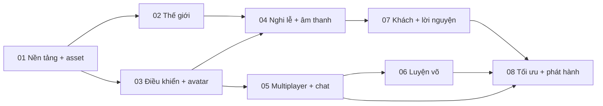

# Virtual Temple Online — Development Roadmap

Ngày chốt: 04/11/2026. Roadmap này chia việc theo module có thể giao riêng cho agent. Không dùng số thứ tự module để suy ra đã hoàn thành; chỉ đánh dấu nghiệm thu sau khi có bằng chứng chạy thực tế.

## 1. Thứ tự và phụ thuộc



## 2. Module MVP

| Module | Deliverable | Nghiệm thu bắt buộc |
| --- | --- | --- |
| 01 · Nền tảng | Next/TypeScript, scripts, env mẫu, asset pipeline | Cài từ lockfile; typecheck/build; GLB hợp lệ; không lộ secret |
| 02 · Thế giới | Sân, chính điện, hồ/vườn, chuông, sân luyện võ | Vào game thấy khung cảnh; đi liền mạch; statue đúng hướng/tỷ lệ |
| 03 · Nhân vật | Avatar rig, Walk/Run, pose, input và camera | WASD theo camera; cảm ứng hoạt động; collision; không trượt khi nghi lễ |
| 04 · Tương tác | E theo khoảng cách, hương/khói, thiền, chuông, nhạc | Prompt đúng điểm; khóa/hủy hành động; mute; âm thanh sau tương tác |
| 05 · Realtime | Room 20 người, nội suy, chat, emote | Hai client thật; khác phòng tách biệt; đủ 20 và từ chối người thứ21; reconnect rõ ràng |
| 06 · Luyện võ | Opt-in, Attack, HP server, KO/hồi sinh | Ngoài sân/không opt-in không gây damage; range/cooldown server; hồi sinh đúng |
| 07 · Persistence | Khách ký cookie, schema Neon, lời nguyện | Refresh giữ hồ sơ; chỉ public xuất hiện công khai; local fallback báo rõ |
| 08 · Phát hành | Low/Medium/High, loading, responsive, deploy guide | Desktop/mobile QA; build production; Worker dry-run; số đo tải và chi phí |

## 3. Giao việc cho agent

Mỗi lần giao một module, dùng mẫu sau:

```text
Đọc docs/GDD.md, docs/TDD.md và docs/ROADMAP.md.
Thực hiện module [số/tên] trên trạng thái repository hiện tại.
Phạm vi file được sở hữu: [...].
Giữ tương thích src/lib/protocol.ts; báo trước nếu đổi protocol/schema.
Hoàn thành các tiêu chí nghiệm thu của module.
Không đưa secret vào client/log. Không ghi tọa độ realtime vào Neon.
Không đánh dấu đã test nếu chỉ viết mã hoặc chạy typecheck.
Bàn giao: file đã đổi, hành vi mới, lệnh kiểm tra/kết quả, giới hạn còn lại.
```

Khi nhiều agent chạy đồng thời, chia ownership file trước. Logic authority và protocol cần một đầu mối; chỉ cập nhật schema database bằng migration bổ sung, có thể review.

## 4. Kịch bản kiểm thử bàn giao

### Kịch bản A — Một người

1. Mở trang ở cửa sổ sạch, chọn tên và một ngoại hình.
2. Đi quanh sân, tới cột, cạnh hồ, chính điện; camera không xuyên vật cản lớn.
3. Đi bộ/chạy/dừng; kiểm tra không còn T-pose sau khi chuyển cảnh hoặc action.
4. Tới bàn thờ, xem prompt, dâng hương và kiểm tra input bị khóa đúng lúc.
5. Ngồi thiền, đứng lên, cúi chào và rung chuông.
6. Bật/tắt nhạc, đổi Low/Medium/High, đổi chế độ sáng/tối nếu có.
7. Gõ chat hoặc lời nguyện; WASD trong input không làm nhân vật chạy.

### Kịch bản B — Hai người và hai phòng

1. Mở hai trình duyệt/tab độc lập vào cùng phòng; mỗi bên thấy bên còn lại.
2. Di chuyển, chạy, đổi hướng; người từ xa chuyển động liên tục giữa các snapshot.
3. Gửi chat/emote, rung chuông, dâng hương; hai bên nhận được sự kiện.
4. Chuyển một client sang phòng khác; không nhận vị trí/chat/sự kiện phòng cũ.
5. Ngắt WebSocket; UI báo đúng trạng thái, không tiếp tục tăng số người online giả.

### Kịch bản C — Luyện võ

1. Đánh khi ngoài sân: không gây damage.
2. Hai người trong sân nhưng một người chưa tham gia: không gây damage.
3. Cả hai tham gia, trong tầm: một đòn hợp lệ giảm14 HP.
4. Gửi nhiều attack trong700 ms: không vượt giới hạn damage.
5. Ra khỏi sân hoặc đứng quá2,4 đơn vị: không gây damage.
6. KO: không tiếp tục đánh/nhận hit; hồi sinh sau5 giây theo server.

### Kịch bản D — Lời nguyện và database

1. Khi thiếu database: UI/API báo local; không tuyên bố đã lưu Neon.
2. Khi có Neon: tạo khách, refresh, hồ sơ còn nguyên.
3. Gửi một lời nguyện riêng tư và một công khai từ hai phiên hợp lệ.
4. API công khai chỉ trả lời nguyện công khai, không chứa playerId.
5. Spam, body quá dài, session giả hoặc schema sai bị từ chối phù hợp.
6. Migration không đụng tới các bảng ngoài tiền tố `vto_`.

## 5. Sau MVP

| Ưu tiên | Hạng mục | Điều kiện bắt đầu |
| --- | --- | --- |
| P1 | Clip Idle/Sit/Bow/Pray riêng | Chốt ngoại hình/rig và quyền asset |
| P1 | Better Auth anonymous/account-link | Khách/persistence ổn, có yêu cầu đồng bộ thiết bị |
| P1 | Moderation, block/report, room token | Chuẩn bị mở cho người lạ |
| P1 | Hiệu năng thực tế và room hibernation | Có benchmark/băng thông/thời gian online |
| P2 | Navmesh cho địa hình nhiều tầng | A* lưới hiện tại không còn đủ cho bản đồ mới |
| P2 | NPC dùng navmesh, chat chỉ gửi theo vùng | Multiplayer và tuyến đường ổn; hiện bong bóng giới hạn 12 m |
| P2 | Âm thanh không gian hoàn chỉnh | Có asset và kiểm thử trên thiết bị |
| P2 | Tiến trình, vật phẩm trang trí | Chốt quy tắc chống spam/authority |
| P3 | PWA, nhiều khu vực, lễ hội | MVP có người dùng và dữ liệu hiệu năng |

Không mở kinh tế vật phẩm hoặc combat cạnh tranh trước khi có định danh ổn định, chống gian lận tốt hơn và vận hành moderation.

## 6. Cổng phát hành

Chỉ công bố bản public sau khi:

- Có quyền sử dụng model và nhạc để phân phối.
- Production secret/origin/WSS cấu hình đúng; `.env` không có trong artifact public.
- Các kịch bản một người, hai người, phòng tách biệt, combat và riêng tư đều có kết quả.
- Đo FPS trên ít nhất một desktop và một điện thoại mục tiêu; ghi cấu hình thiết bị.
- Theo dõi hạn mức Vercel, Cloudflare và Neon; không coi mục tiêu0đ là cam kết.
- Có cách xem lỗi, khóa spam, và quay lại bản deploy trước khi có sự cố.

Bản bàn giao local không tự đồng nghĩa đã deploy Vercel/Cloudflare hoặc đã nghiệm thu đủ20 avatar trên mobile.
