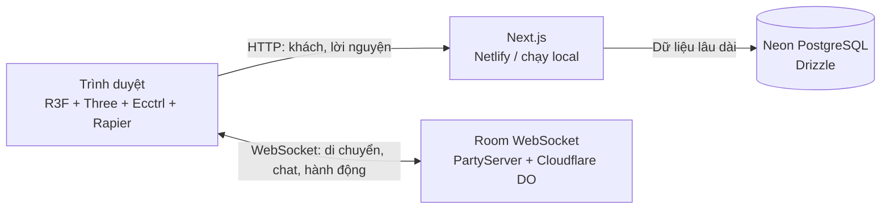

# Virtual Temple Online — Technical Design Document

Phiên bản 0.1 · 04/11/2026. Đọc cùng `GDD.md`, `ROADMAP.md` và README để phân biệt thiết kế, tính năng có mã nguồn và kết quả kiểm thử.

## 1. Phân chia trách nhiệm

Tọa độ, chat tạm và HP thuộc trạng thái phòng. Neon chỉ lưu hồ sơ khách và lời nguyện trong phiên bản đầu. Không ghi tọa độ vào database theo mỗi lần nhân vật di chuyển.

Next.js phục vụ ứng dụng và API. Realtime chạy riêng qua Cloudflare; không phụ thuộc việc nền tảng web hỗ trợ WebSocket hay không. Khi phát triển, Node `ws` dùng cùng logic phòng với Worker.

## 2. Stack đã chọn

| Phần | Công nghệ |
| --- | --- |
| Ứng dụng web | Next.js App Router, React, TypeScript |
| Scene | Three.js, React Three Fiber, Drei |
| Điều khiển và vật lý | Ecctrl 2.x, React Three Rapier |
| Animation | Three AnimationMixer qua Drei useAnimations |
| Client state | Zustand và state/ref theo vòng đời UI/render |
| Realtime production | PartyServer trên Cloudflare Durable Objects |
| Realtime local | Node `ws`, cùng Room engine |
| Database | Neon serverless + Drizzle ORM |
| Validation | Zod và kiểm tra giới hạn server |
| Asset preparation | Node.js + Sharp; GLB 2.0 nhúng JPEG/PNG |
| Kiểm thử | TypeScript, Vitest, kiểm tra hai client WebSocket, Browser |
| Quản lý gói | pnpm, lockfile là nguồn phiên bản thực tế |

Kế hoạch Better Auth anonymous/account-link được giữ cho module tài khoản mở rộng. Bản đầu dùng cookie phiên khách ký HMAC; không gọi đây là đăng nhập tài khoản đầy đủ. Client dùng native WebSocket; PartySocket có thể thêm nếu cần transport reconnect thống nhất.

## 3. Cấu trúc module

| Đường dẫn | Trách nhiệm |
| --- | --- |
| `src/app/` | Trang game, layout, stylesheet và API |
| `src/components/game/World.tsx` | Chùa, cảnh quan, ánh sáng và hiệu ứng môi trường |
| `src/components/game/Avatar.tsx` | Clone rig, vật liệu, animation, pose và nameplate |
| `src/components/game/` | Canvas, nhân vật cục bộ/từ xa và HUD |
| `src/lib/protocol.ts` | Kiểu wire protocol và hằng số phòng/arena |
| `src/lib/server/` | Session cookie, database, schema và persistence |
| `server/room.ts` | Logic authoritative dùng chung local/Cloudflare |
| `server/worker.ts` | PartyServer adapter |
| `scripts/dev-realtime.ts` | WebSocket server khi chạy local |
| `scripts/prepare-assets.mjs` | Tối ưu model từ file gốc |
| `drizzle/` | Migration SQL bổ sung bảng game |
| `public/assets/` | Asset game sẵn sàng phục vụ |
| `docs/` | GDD, TDD và roadmap |

## 4. Asset pipeline

Bảy file GLB gốc được giữ nguyên ở thư mục dự án. Bốn bản xuất avatar dùng cùng mesh 12.092 vertices, cùng rig 32 xương và cùng texture. Script gộp riêng animation vào một GLB để không tải texture/mesh bốn lần.

| Asset web | Dung lượng xấp xỉ | Nội dung |
| --- | --- | --- |
| `avatar.glb` | 1,59 MiB | Một nhân vật, Walk/Run/Attack/Agree |
| `buddha-center.glb` | 1,99 MiB | Tượng giữa |
| `buddha-left.glb` | 1,98 MiB | Tượng trái |
| `buddha-right.glb` | 2,08 MiB | Tượng phải |
| `temple-ambient.mp3` | 4,11 MiB | Nhạc người dùng cung cấp |

Tổng model giảm từ khoảng 291 MiB xuống 7,64 MiB. Texture giới hạn 1024 px, nhúng trực tiếp JPEG/PNG trong GLB; không tải Draco/Meshopt decoder từ CDN. `public/assets/manifest.json` chứa kích thước byte và clip thật. Chạy lại bằng `pnpm assets`.

Các GLB đã được kiểm tra bằng Khronos glTF Validator: không có lỗi. Cảnh báo kế thừa gồm thiếu tangent dựng sẵn và node skinned mesh nằm dưới armature. Three.js xử lý khi render; kiểm tra hình ảnh thực tế vẫn cần thiết.

Avatar dùng `SkeletonUtils.clone` cho mỗi instance; vật liệu tint cũng clone riêng để không đổi màu người khác. Các geometry và texture chung có thể dùng lại. Không dispose tài nguyên GLTF cache khi một người rời phòng; chỉ dispose vật liệu instance sở hữu.

Idle lấy pose ở đầu Agree. Sit/Bow/Pray là pose runtime, không phải clip xuất từ phần mềm animation. Các bone `mixamorig:*` được nội suy quaternion; không thay toàn bộ góc Euler bằng 0. Khi chuyển sang clip gốc, AnimationMixer crossfade khoảng 180 ms.

## 5. Character controller và camera

Client tự mô phỏng nhân vật cục bộ qua Ecctrl/Rapier để đầu vào phản hồi ngay. Camera bám nhân vật theo góc nhìn thứ ba, di chuyển tương đối theo hướng camera, có kiểm tra vật cản và khoảng cách tối thiểu. Collider là hình đơn giản gần với công trình; không dùng mesh chi tiết của tượng làm collider động.

Nghi lễ là state có thời hạn. Bắt đầu nghi lễ hủy vận tốc, giữ vị trí hiện tại trong phạm vi tương tác và khóa input di chuyển; kết thúc hoặc hủy nghi lễ khôi phục input. Chat/input/modal có quyền ưu tiên trên phím game. Mất focus phải xóa phím đang giữ. Tự căn vị trí và hướng vào animation tương tác chính xác là phần có thể cải thiện khi có clip nghi lễ riêng.

Click-to-move hiện dùng A* lưới 1 đơn vị trong `world-layout.ts`, kiểm tra vật cản chung với collision và chặn cắt góc chéo. Năm bài kiểm tra đường đi bao gồm hồ, chính điện, cột và cổng. Navmesh có thể thay thế khi cần địa hình nhiều tầng hoặc bản đồ lớn.

## 6. Wire protocol

Nguồn chính là union type trong `src/lib/protocol.ts`. WebSocket URL local có dạng `/parties/temple/lotus-1` trên cổng 1999; production dùng Worker URL cùng đường dẫn.

| Client → Server | Mục đích |
| --- | --- |
| `join` | Tên và chỉ số avatar 0–3 |
| `move` | X/Z, yaw, animation |
| `chat` | Văn bản chat |
| `action` | Sit, bow, pray, incense, bell, wave, idle |
| `emote` | Cảm xúc nằm trong tập cho phép |
| `combat` | Tham gia/rời luyện võ |
| `attack` | Yêu cầu đánh; có thể chỉ định đối thủ |
| `ping` | Kiểm tra kết nối |

| Server → Client | Mục đích |
| --- | --- |
| `welcome` | ID phiên realtime, danh sách người chơi, phòng và sức chứa |
| `state` | Snapshot người chơi của phòng |
| `chat` | Tin nhắn có ID, người gửi và thời điểm server |
| `event` | Incense, bell, emote, hit hoặc respawn |
| `error` | Lỗi có thể hiển thị cho người chơi |
| `pong` | Thời điểm phản hồi |

Mỗi phòng tối đa 20 người. Snapshot 10 Hz; render tự chạy theo FPS thiết bị. Client không gửi toàn bộ model/animation qua mạng. Người từ xa nội suy giữa vị trí cũ/mới; không cập nhật React state cho từng frame vật lý.

Server chặn payload quá lớn, schema sai, số không hữu hạn, vị trí ngoài biên, packet quá nhanh và bước di chuyển vượt tốc độ cho phép. Giới hạn ban đầu: 35 packet/giây/client, khoảng cách giữa move ít nhất 65 ms, tốc độ tối đa 9,5 đơn vị/giây cộng dung sai. Đường đi được lấy mẫu mỗi 0,2 đơn vị và kiểm tra trên hình học chặn dùng chung với client, có margin0,25. Đây là bảo vệ cơ bản; server chưa chạy mô phỏng Rapier toàn bản đồ nên cần kiểm thử gian lận trước khi phát hành cạnh tranh.

Khách realtime có thể tự chọn tên hiển thị. ID WebSocket không phải tài khoản được xác thực bền vững. Chưa dùng room token gắn session guest; cần thêm nếu triển khai moderation, quyền sở hữu hoặc phần thưởng có giá trị.

## 7. Combat authority

Arena: X 14–24, Z 0–12. Server kiểm tra cả hai người đang trong vùng và đã opt-in, mục tiêu còn sống, khoảng cách ≤ 2,4, cooldown ≥ 700 ms. Mỗi hit giảm 14 HP từ 100; KO khóa trạng thái và hồi sinh sau 5 giây.

Client không gửi lượng damage hoặc HP. Animation Attack chỉ là hình ảnh của yêu cầu đánh; event hit xác nhận kết quả. Không nhận XP/vật phẩm/công đức từ hit trong bản đầu.

## 8. Database và API

| Bảng | Dữ liệu |
| --- | --- |
| `vto_players` | ID khách, tên, avatar, merit, thời điểm tạo/cập nhật |
| `vto_prayers` | ID, playerId, tên hiển thị, nội dung, isPublic, thời điểm tạo |

Migration chỉ bổ sung các bảng mang tiền tố `vto_`; không xóa/thay đổi bảng có sẵn. Tọa độ, tin chat tạm và HP không ghi vào các bảng này.

| API | Hành vi |
| --- | --- |
| `GET /api/guest` | Lấy phiên khách và trạng thái lưu dữ liệu |
| `POST /api/guest` | Tạo/cập nhật tên, avatar và cookie ký |
| `GET /api/prayers` | Tối đa 40 lời nguyện công khai gần nhất, không trả playerId |
| `POST /api/prayers` | Lời nguyện ≤500 ký tự, mặc định riêng tư, cooldown ≥30 giây |

Cookie dùng chữ ký HMAC, HttpOnly, SameSite và Secure trong production. `SESSION_SECRET` phải đủ dài khi public deploy. API không tin playerId tùy ý trong body mà lấy từ session server. Khi dùng PostgreSQL, cooldown lời nguyện dùng khóa giao dịch advisory và insert có điều kiện để tránh gửi đồng thời vượt giới hạn.

Có `DATABASE_URL` thì dùng Neon HTTP driver qua Drizzle. Có hỗ trợ khóa `NEON_KEY` của môi trường hiện tại nếu giá trị thực sự là PostgreSQL URL; không chuyển khóa này sang biến `NEXT_PUBLIC_*`. Thiếu database, chế độ local chỉ giữ dữ liệu trong bộ nhớ Node và phải hiện rõ; mất tiến trình sẽ mất dữ liệu đó. Migration bổ sung đã chạy thành công trên Neon được cấu hình trong phiên làm việc ban đầu; các trường thưởng merit giữ0, không cấp điểm bằng nghi lễ.

## 9. Cấu hình và vận hành

`pnpm dev` chạy Next và WebSocket local. `pnpm build` đóng gói web; `pnpm start` chạy bản build. `pnpm db:migrate` áp dụng migration bổ sung trên database cấu hình. `pnpm deploy:realtime` triển khai Worker khi có tài khoản Cloudflare đã đăng nhập.

Các biến chính:

- `DATABASE_URL`: PostgreSQL URL, chỉ server.
- `SESSION_SECRET`: bí mật ký cookie, chỉ server; ít nhất 32 ký tự khi production.
- `REALTIME_URL`: URL server phòng public, đọc lúc chạy qua `/api/realtime/config`; alias `NEXT_PUBLIC_REALTIME_URL` vẫn được hỗ trợ. Production mặc định dùng Worker trong `src/lib/realtime-default.json`, local dùng cổng 1999. Không chứa secret.
- `ALLOWED_ORIGIN`: origin web được phép kết nối Worker.

Deploy web lên Netlify và realtime lên Cloudflare là hai bước riêng. `netlify.toml` dùng `pnpm build` và `.next`, giữ API/cookie trên Next.js adapter. Import `.env.netlify` qua UI với scope Builds và Functions; dùng nhóm `NEON_STORAGE_*` thay tên AWS dành riêng. Worker hiện có là mặc định; khi đổi server, cấu hình `REALTIME_URL` trong Functions rồi redeploy web. Cấu hình origin Worker và Neon Realtime trùng URL web production. HTTPS web phải dùng WSS. Không commit `.env` hoặc dán giá trị secret vào log. Xem [hướng dẫn Netlify](DEPLOY_NETLIFY.md).

Worker phiên bản đầu giữ vòng tick khi phòng đang hoạt động (`hibernate = false`), dừng timer sau khi người cuối cùng rời phòng. Snapshot chỉ phát khi trạng thái đổi, tối đa khoảng 10 Hz. Mục tiêu gần 0 đồng phụ thuộc hạn mức, thời gian online, băng thông model và số kết nối. Tối ưu tiếp theo là hibernation sau khi có số đo.

## 10. Kiểm thử và giới hạn

Kiểm tra tự động tập trung logic quan trọng: sức chứa/phòng tách biệt, validation, spam chat, di chuyển, cooldown, nghi lễ theo vị trí, combat opt-in/HP/hồi sinh và quyền riêng tư lời nguyện. Chạy TypeScript cho ứng dụng và Worker riêng.

Browser cần kiểm tra màn hình gia nhập, cảnh thật, điều khiển, thao tác chạm, loading, mute và đổi chất lượng. Hai client WebSocket xác nhận trao đổi thật; kiểm thử 20 socket xác nhận sức chứa không thay thế đo FPS 20 avatar trên thiết bị thật.

Chưa coi các mục sau là đã hoàn thành nếu chưa có nghiệm thu riêng: Better Auth/account-link, moderation/report, navmesh địa hình nhiều tầng, animation nghi lễ do nghệ sĩ làm, PWA/offline, nhiều map, sự kiện lễ hội, mua bán/vật phẩm, scale nhiều khu vực, khả năng phục hồi room qua deploy và benchmark thiết bị thật.

## 11. Tài liệu kỹ thuật chính thức

- [React Three Fiber](https://r3f.docs.pmnd.rs/getting-started/introduction): mô hình renderer React cho Three.js và tương thích phiên bản React.
- [Ecctrl](https://github.com/pmndrs/ecctrl): character controller, camera và tích hợp Rapier.
- [Cloudflare Durable Objects](https://developers.cloudflare.com/durable-objects/): room/state phối hợp và WebSocket.
- [Drizzle + Neon](https://orm.drizzle.team/docs/connect-neon): driver Neon HTTP/WebSocket cho môi trường serverless.
- [glTF Transform](https://gltf-transform.dev/): tài liệu pipeline glTF tham khảo; script hiện tại xử lý GLB và Sharp trực tiếp để giữ codec đơn giản.
- [Khronos glTF Validator](https://github.com/KhronosGroup/glTF-Validator): kiểm tra tính hợp lệ asset.
